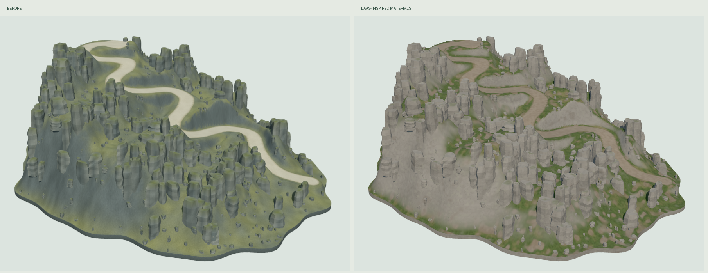

# 山体预览材质调整 · 2026-10-10

按用户指定的 [Braffolk/fable5-world-demo](https://github.com/Braffolk/fable5-world-demo) 参考，完成独立 Three.js 山体预览的材质与灯光调整。预览地址：`http://127.0.0.1:5188/mountain-model.html`。

## 参考与实现

只读参考版本：`fd75fdb718996908aad3d22b59dfa297dc94298d`。

- [TerrainMaterial.ts](https://github.com/Braffolk/fable5-world-demo/blob/fd75fdb718996908aad3d22b59dfa297dc94298d/src/render/TerrainMaterial.ts)：参考其坡度控制的岩石、土壤与草地过渡，以及多尺度程序细节。
- [VegMaterials.ts](https://github.com/Braffolk/fable5-world-demo/blob/fd75fdb718996908aad3d22b59dfa297dc94298d/src/render/VegMaterials.ts)：参考暖灰岩石、地衣、朝上表面苔藓及粗糙度变化。
- [ColorScript.ts](https://github.com/Braffolk/fable5-world-demo/blob/fd75fdb718996908aad3d22b59dfa297dc94298d/src/render/ColorScript.ts)：参考暖阳光与冷色环境光关系。

新增 `src/models/SectMountainMaterials.ts`，以原创 WebGL 着色器扩展现有 `MeshStandardMaterial`。共用一张 512×512、可平铺的线性数据纹理，进行世界空间三向投射；宏观色块、中尺度风化、细裂隙和近景颗粒分别控制。草地/裸土按表面坡度混合，岩石添加低对比层理与地衣，道路采用土色碎石及柔和草地边缘。保留 Three.js PBR、阴影及光照流程，使用 AgX 色调映射。

没有复制参考项目源码或贴图，也没有移植其 WebGPU、GI、植被或云系统。成果是当前模型的材质风格适配；几何轮廓仍为此前的程序山体近似重建。

## 范围与验证

- 仅变更独立山体预览；游戏渲染入口、地形、碰撞与存档代码未改动，原 GLB 保留。
- 模型仍为 156,848 三角形、5 网格、200 岩柱、480 碎石，山路宽度与几何位置不变。
- `npm run build` 通过；`npx playwright test tests/mountain-model.spec.ts tests/mountain-material.spec.ts` 最终 4 项检查全部通过（10.0 秒）。
- 273 个道路射线采样、真实鼠标/滚轮/键盘、图层/线框反复切换、页面资源隔离与 390×844 布局检查通过。
- 六个视角、线框、真实输入和窄屏截图均已检查；页面及控制台错误 0，着色器失败 0。GPU 为 RTX 4050，测试专用 X11 启动。
- 全景 6 calls / 156,850 渲染三角形（含展示底板）；图层反复切换前后均为 6 geometries / 4 textures，无递增。`evidence.json` 的 `before` / `after` 指同一最终材质下的切换循环前后，不是旧版和新版性能对比。
- 源码 review 检查了世界空间法线、材质程序缓存键、纹理共用与释放、道路边缘属性，以及游戏入口隔离；相关 diff 无空白错误。

用户当前浏览器标签的自动控制受到 URL 安全规则阻止，本轮未控制该标签。画面与真实输入证据来自项目独立生产测试页面；刷新现有预览即可查看结果。

## 证据

- `before-road.png`：之前已提交的旧材质截图副本。
- `road.png` / `front.png` / `side.png` / `top.png` / `summit.png` / `bottom.png`：最终六视角。
- `wireframe.png` / `mouse-keyboard.png` / `mobile.png`：线框、真实输入与窄屏。
- `comparison.png` / `contact-sheet.png`：前后对比与最终视角总览。
- `evidence.json`：模型、渲染、资源稳定性与错误检查记录。

实现提交将在完成后记录于 `commit-record.json` 与 `artifacts/game-progress.md`；本模块仅作本地提交，不 push。
