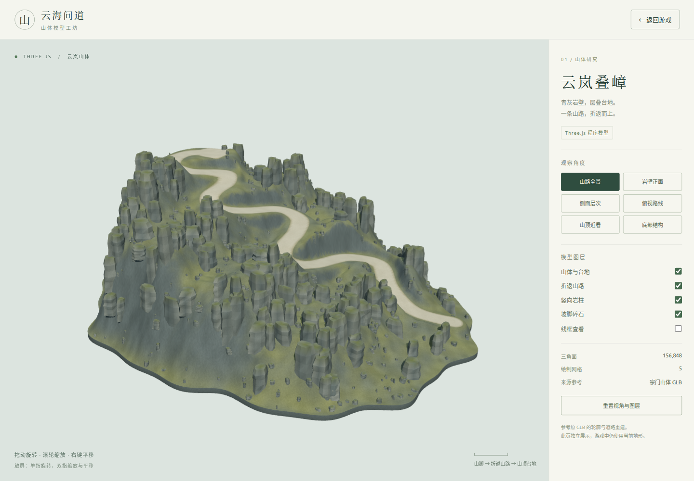

# 云岚山体 · Three.js 独立模型预览

按用户 2026-10-10 新要求，参考现有 Meshy 山体 GLB，用 Three.js 程序几何重建，独立展示；此单元不替换游戏地形，不推进 GLB 拼接/碰撞验收。

- 开发入口：`http://127.0.0.1:5188/mountain-model.html`。生产构建同时产出 `index.html` 和 `mountain-model.html`，相对链接适用于子目录部署。
- 参考原件：`artifacts/terrain-pipeline/concepts/sect-mountain-v1/mountain-body/meshy-models/glb.glb`，SHA-256 `ef20950c8e9631fe32ad89f224104d53b51def3a412266e5e80579ba17074570`。
- 实现：`src/models/SectMountainModel.ts` 自建连续台地、封底、折返路、岩柱和碎石；不加载原件、不复制原网格/贴图/高度图。道路地标用于手工编写样条控制点，整体轮廓与岩石是程序化近似，未宣称逐顶点或像素级复刻。
- 面板：六种视角、四个图层、线框、重置，鼠标旋转/缩放/平移与触屏操作；画布聚焦后方向键旋转、`+/-` 缩放、`R/Home` 重置。按需渲染，无后台动画循环。
- 模型共 156,848 面、5 个网格，200 个宽岩柱和480块碎石合批；包围盒约195.25×78.32×157.31预览单位，9.2为预览路宽参数，不是游戏最终标定或五人通行验收。
- `npm run build` 通过；`tests/mountain-model.spec.ts` 三项通过，包括273个道路射线落点、铺面与实际三角地表9cm间隔、真实鼠标/滚轮/键盘、面板与窄屏可达性、无GLB/游戏模块请求和localStorage隔离。
- RTX4050：六视角、底部、分层、线框、鼠标/键盘与390×844窄屏画面已审查，页面/控制台错误0。正常全景色彩渲染6 calls / 156,850面（含展示底面），6 geometries / 5 textures；详见 `evidence.json`。这是独立预览统计，不能当成游戏总场景性能。
- 代码review修复：原解析高度与渲染三角插值不一致导致路面吞没；改为裁切原地表三角生成铺面。折返内侧高度切换改为连续加权，峰顶平整先于道路整平；查询视角用自有属性校验，补齐事件及阴影资源清理。

九视角联系图见 `contact-sheet.png`，窄屏见 `mobile.png`。初次测试的桌面滚动条宽度断言错误已修正；直接导航到正在初始化的大型游戏后立即关闭测试上下文曾超时，预览布局单测改为检查返回链接，完整游戏往返由入口集成单元验证。

## 游戏入口与往返验证

游戏标题页和 `Esc` 暂停菜单新增“山体模型 ↗”链接，在新标签页打开预览，原游戏页面与状态保留。从游戏打开后，预览的“返回游戏”关闭该页；直接打开模型页面时，该链接进入游戏主页。原地形、任务、碰撞、控制器和存档格式没有改动，模型代码不进入游戏入口的请求路径。

`tests/mountain-preview-navigation.spec.ts` 真实输入验证通过（12.0秒，RTX4050）：标题打开/返回；进入游戏按W行走、Esc暂停并保存；再次打开预览、切俯视和线框、返回后继续W移动。往返位置 `(0,90,47.394043269634544)`、气血/真气/修为/境界/任务/物品和完整localStorage均相同，两个预览页均正常关闭，原游戏页保留，页面错误0。截图与数据在 `navigation/`。

首次多标签测试因本机Chromium的Wayland/GBM图形进程崩溃而超时；导航测试单独使用X11模式，同一RTX4050硬件渲染完成重跑，不改游戏或全局浏览器设置。最终生产构建通过；3项模型测试和1项游戏往返测试分别通过。模型实现提交 `1037f5e9c0444a341febdd25eee232b2ea663d08`，HEAD中文UTF-8已核验；入口提交记录在制作进度中。
