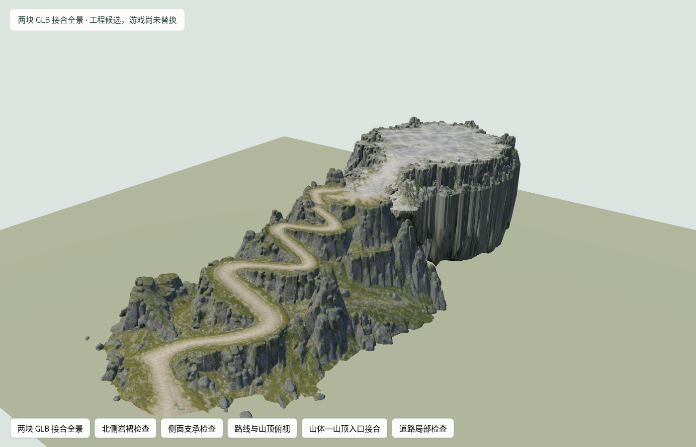

# 两块 GLB 接合试验 v1：未通过

此目录为失败诊断，不是游戏可玩成果。游戏源码与public运行时资源未修改，无新增Meshy任务，原件保持。

从两个源GLB的已保存俯视图选取路线/入口，再用真实三角形射线交点记录源坐标。试验以山体220倍、山顶150倍及对应旋转/平移对齐：山脚高度2m，路线约778m，山顶参考高度141.29m。这些是本次候选变换，非最终地图尺寸；9.6m平整核心只代表处理参数，未通过道路净宽验收。

本方案尝试把山顶下方岩裙延伸到山体/谷地，最多延长102.14m，严重拉伸岩壁贴图。当前岩裙支承及山顶轮廓因此不接受。道路局部平整后，28035个九横向位置探针（五条中心、两条身体外缘、两条净宽外缘）仍有158个陡面样本、1752个相对目标高差超过30cm的样本；最大高差1.632m、相邻探针最大纵坡6.217。没有缺失射线交点，不代表可走或封闭。障碍净空、转弯身体包络、三维碰撞及真实输入均未通过/未执行。

此失败证明该候选处理方案不适合启用，并不证明两块源件所有可能变换都无法接合。为避免继续大幅修改批准形状，下一步生成保留宽阔山顶方向的一体山体v2概念，审批后才允许对应修正建模；两个v1原件继续保留可复用。未批准新图前，不新增付费任务。

保存工具：`scripts/measure-sect-terrain.mjs`、`scripts/prepare-sect-terrain.mjs`、`scripts/check-sect-terrain-floor.mjs`；公共容器/三角形查询在`terrain-glb.mjs`。source-measurements.json包含真实源SHA；layout.json记录变换和局部加工；derived仅是失败候选，不复制至public。floor-check.json为探针原始统计，六视图与render.json为独立预览证据，不能代替游戏GPU性能。

修整算法读取不变的山顶快照再写输出，防止原坐标查询混入加工坐标；原件及派生容器/纹理完整性、来源哈希与截图另行核验。预览由仓库静态服务器5198提供，按钮可切换六视图。
