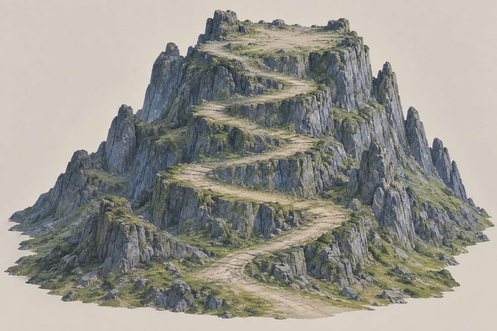

# 云岚宗山体 v1 · 待地形图审批

单一完整宗门山体，包含大面积峰顶建筑预留、宽阔盘山路和山脚过渡。由内置 image_gen 生成，供本批地形图审批；批准后才作为 Meshy Image to 3D 输入。建筑由 Three.js 独立制作，未嵌入此图。

## 尺度与本轮审批范围

- 采用地图 v1 的相对比例，以正常约1.8m角色与上山道路作为标尺，重新标定山体、山顶和建筑占地。
- 路段目标通行净宽8m，最低7m，足以容纳五个直径约1.1m的角色及间隔/边缘余量；转弯平台10–12m。山门、台阶和地形接缝也要符合净空要求。
- 请确认这张地形图的山体轮廓、山顶空间、宽路走向和材质方向。图像不能证明实际尺寸/坡度，GLB生成后由AI测量与修整，实机验证连续通行。
- 当前只有概念图，尚未获得本图审批、提交Meshy任务或改造运行时道路。总览地图的附条件采用不代替本张输入图审批。

[完整提示词](prompt.txt)、[图像检查记录](review.json)、[活跃计划](../../../plan.json)、[工作流](../../../../../docs/ai-terrain-workflow.md)。工具返回的原始图片保留；项目副本与原图字节完全一致。
