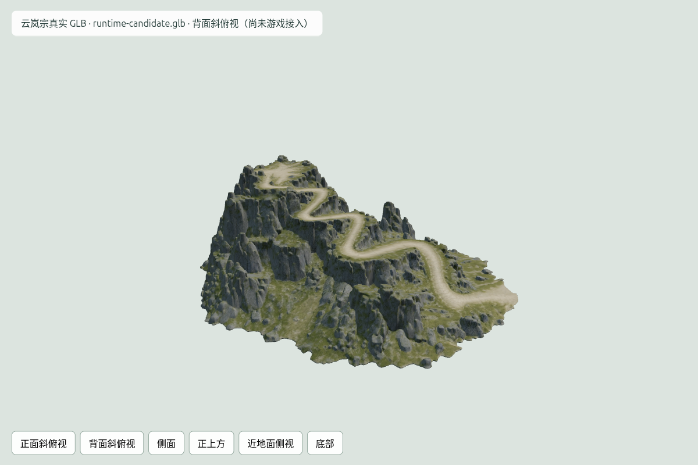

# 第一块云岚宗山体：真实 GLB 源资产检查

任务 `01a1247e-06ab-73f1-8899-138582587c9a` 使用用户已批准的山体原图，真实 Meshy API 返回 SUCCEEDED，消耗30 credits。两个原件均已下载并按实际字节计算 SHA-256，未重生成。

| 文件 | 大小 | 三角面 | 用途 |
|---|---:|---:|---|
| [Meshy 纹理原件](../meshy-models/glb.glb) | 17,638,564 bytes | 103,529 | 保留原始纹理输出 |
| [减面前原件](../meshy-models/pre_remeshed_glb.glb) | 28,809,252 bytes | 1,200,388 | 保留高面数无纹理几何 |
| [纹理打包候选](../meshy-models/runtime-candidate.glb) | 15,038,376 bytes | 103,529 | 候选，尚未放入游戏 |

三张2048×2048纹理均可解码；一个mesh、一个material，无动画和必需外部文件。源坐标包围盒约1.8932×0.6543×1.5552，此数不是米，尚未完成世界尺度标定。候选只改纹理编码，4个非图像bufferView、mesh/accessor/node/scene/material等元数据与源件完全一致；非颜色贴图保留逐通道原像素，颜色图WebP quality 98。

RTX4050分别加载原件、减面前网格及候选，各六个视角，浏览器零错误。候选与纹理原件的六视角同机、同镜头、同光照比较（排除UI条），RGB RMSE为0.183–0.487/255，未见轮廓或画面破坏。该渲染每帧1 call / 103529 triangles只是孤立资产检查，不是游戏总画面性能验收。独立review复核了非图像字节、元数据、非颜色像素与候选截图，未发现本整理单元阻塞缺陷。

视觉上保留连续折返路、岩壁、山脚、峰顶轮廓和原图风格；底部封面在视图中可见。拓扑诊断仍检出110条边界边、53条非流形边（exact位置焊接及1e-7至1e-5容差结果相同），不能据底部截图宣称闭合或碰撞安全。后续须定位/修整这些接触，并测量实际道路净宽、坡度、山顶建筑空间、地基与接缝。

目前未改运行时地形、道路或山门，未验证五人并行；建筑仍使用Three.js。按工作流继续山顶平台等计划资产的独立输入图审批及工程拼接，不把模型生成成功当作可玩样区完成。

证据：[下载检查点](../meshy-job.json)、[文件统计](file-glb-stats.json)、[拓扑诊断](geometric-review.json)、[打包字节与纹理检查](../meshy-models/runtime-candidate.json)、[RTX4050候选统计](packed-stats.json)、[六视角比较](texture-render-comparison.json)。`index.html`为技术预览；从仓库启动127.0.0.1:5198静态服务器后可浏览，不是游戏画面。
