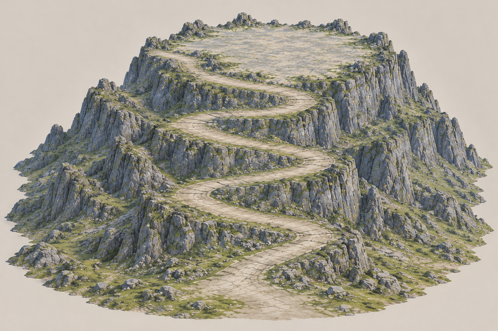

# 云岚宗一体宽峰山体 v2 · 已批准

原山体与独立山顶的首个工程接合候选未通过：过长的山顶岩裙造成纹理拉伸，道路地面探针仍有陡面与高差。两份原始GLB保存不变；失败候选没有启用游戏。此图沿用用户批准的折返道路、宽阔山顶与青灰岩方向，改为山体直接承托整个大山顶的一体结构。

设计意图为约400×450m山体、140m峰顶、170×150m山顶用地，上山路目标8m净宽。上述数字没有印到图中，仍需实际GLB测量；图片与生成成功不能证明五人通行。

使用内置GPT image_gen一次生成，两个批准输入图仅作为参考；源图、完整提示词、副本、SHA-256、CRC/Pillow检查见review.json。用户回复“可以，按这张图生成”独立批准本图，SHA-256为 `5df5d475443b08180d64ebed15119089a9fd554607dce3e61ce2fdcbd9999f65`。可执行一次已诊断的山体修正生成，不重复生成旧平台；真实任务状态以meshy-job.json及plan为准。
