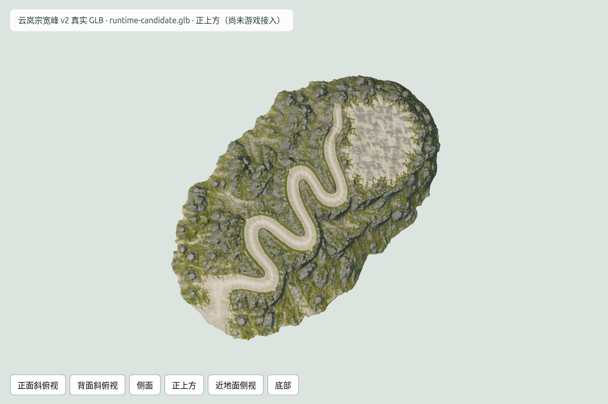

# 一体宽峰山体 v2：真实源 GLB 检查

批准图只提交一次修正。任务 `01a124ef-f012-7717-8d82-6ef6865aace7` 已SUCCEEDED，30 credits；累计90 credits。原始纹理GLB 18,256,548 bytes/103772面，减面前GLB 23,096,728 bytes/962322面，均保留。

纹理候选15,352,660 bytes/103772面。4个非图像bufferView、几何/节点/场景/材质元数据保持，法线逐像素保持，金属粗糙度贴图保留原JPEG字节，颜色图WebP quality98且alpha不变。三容器和嵌入2k贴图完整解码；文件精确SHA在file-*-stats.json和候选打包报告。

纹理原件与候选各六个RTX4050视图，共12张PNG，浏览器零错误，六视角RGB RMSE最大0.4233/255，比较记录在texture-render-comparison.json。独立review复核几何/材质/非颜色像素与候选六视图，无本整理单元阻塞缺陷。轮廓保留连续折返路、一体峰顶、山肩和山脚；侧面偏扁，实际世界高度与道路坡度需工程标定。孤立加载1call/103772面，不是游戏总画面性能。

源包围盒1.18033×0.282682×1.901987（非米），无动画。源拓扑诊断96条边界边、47条非流形边、零退化面；后续定位并验证道路接触及三维碰撞，不能称作封闭安全地形。未验证五人净宽、山顶建筑用地或地基，未替换游戏。
