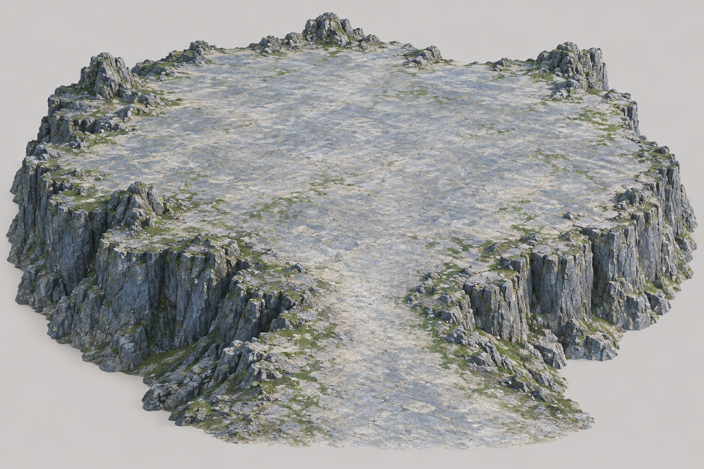

# 云岚宗山顶平台 v1 · 地形图已批准

下一块计划资产是宗门山顶平台，与已经生成的Meshy山体拼接。图中仅含自然地形：大面积空旷平顶、外围青灰岩壁、少量苔藓和前方中央的上山接入口；主殿与各院落继续由Three.js独立制作。

设计目标为约170×150m可用山顶建筑用地，约20m岩裙供接合，主入口最低7m/目标8m通行净宽。这些是后续GLB标定目标，不是已从图片测出的尺寸，不表示游戏已替换地形或五人通行已验收。

用户回复“这个可以”批准本图的轮廓、空间感、入口位置与材质方向；精确SHA-256为 `28cb5c9861e6eb3afe71c6ea03d14314c4d54d63a95e2e2304fba2dab17cfcc5`。审批仅覆盖本图，当前待提交对应Meshy任务；已批准并生成的山体无需重新审批。

第一次内置图像请求长时间无返回，本机未发现输出文件；终止等待后使用同一内置服务重试一次成功。第一请求的底层服务结果未知，没有虚构错误原因；原始提示词、重试提示词与输出原图均保留。副本与工具保存的PNG完全一致，CRC和Pillow完整性检查通过。

[检查与精确哈希](review.json)、[实际成功提示词](prompt-retry.txt)、[第一次提示词](prompt.txt)、[活跃计划](../../../plan.json)、[工作流](../../../../../docs/ai-terrain-workflow.md)。
