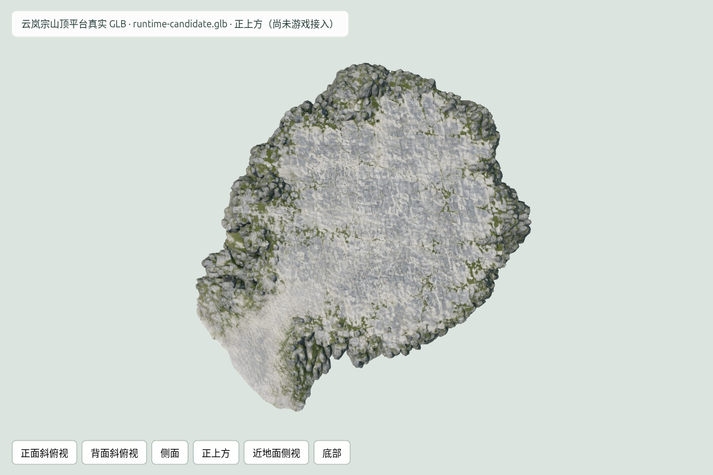

# 云岚宗山顶平台：真实 GLB 源资产检查

用户批准的山顶图只提交一次。Meshy任务 `01a124a3-07d1-7086-9a37-43bbcd5e2d0c` 返回SUCCEEDED，消耗30 credits；本工作流两次受理累计60 credits。原件和候选均保留，未重生成。

| 文件 | 大小 | 三角面 | 用途 |
|---|---:|---:|---|
| [纹理原件](../meshy-models/glb.glb) | 17,608,216 bytes | 62,236 | Meshy原始输出 |
| [减面前原件](../meshy-models/pre_remeshed_glb.glb) | 21,762,424 bytes | 906,736 | 高面数无纹理源件 |
| [纹理打包候选](../meshy-models/runtime-candidate.glb) | 14,646,008 bytes | 62,236 | 尚未放入游戏 |

三个容器与三张2048×2048纹理完整解码，SHA-256与检查点/打包报告一致；一网格、一材质、无动画。候选4个非图像bufferView字节及几何/场景/材质元数据保持一致。法线贴图逐像素保留，金属粗糙度贴图保留原JPEG字节，颜色贴图使用WebP quality98且alpha不变。

RTX4050分别加载原件、减面前原件和候选，各六视角；18张PNG完整，浏览器零错误。候选与纹理原件同机六视角RGB RMSE为0.152–0.489/255（排除UI），未见打包破坏。独立review复核候选数据和六视图，宽阔顶面、前方入口与岩裙均保留。孤立渲染1call/62236面，不代表游戏总画面性能。

源包围盒为1.43862×0.29882×1.89748，源单位尚未标定为米。拓扑诊断有59条边界边、30条非流形边，零退化面，需定位和工程修整；截图不证明闭合或碰撞安全。实际山体接合、建筑用地/地基、主入口净宽和坡度待验证，170×150m仍是设计目标。游戏地形未替换，五人并行未验收。

证据：[下载检查点](../meshy-job.json)、[文件统计](file-glb-stats.json)、[拓扑诊断](geometric-review.json)、[打包检查](../meshy-models/runtime-candidate.json)、[GPU统计](packed-stats.json)、[六视角比较](texture-render-comparison.json)。技术预览index.html由仓库静态服务器5198提供。
